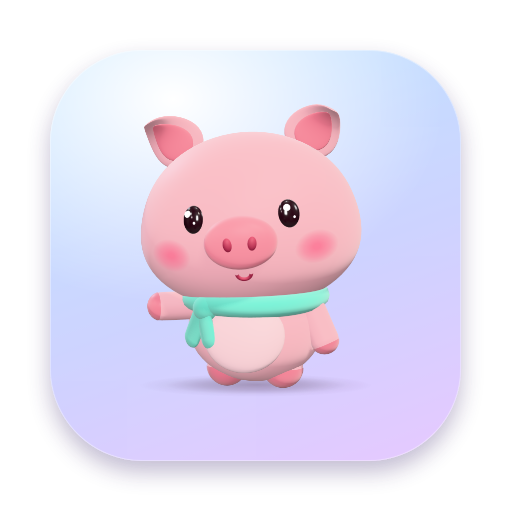
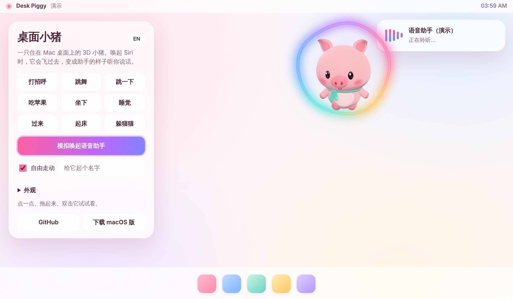
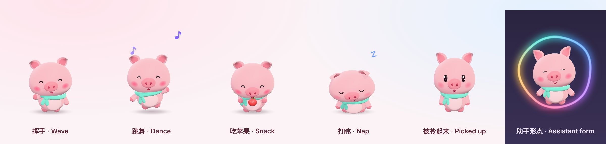

<p align="center"></p>

<h1 align="center">桌面小猪 · Desk Piggy</h1>

<p align="center">
一只住在 Mac 桌面上的 3D 小猪。<br>
唤起 Siri 时，它会飞过去，变成 Siri 的样子听你说话。
</p>

<p align="center">
<a href="https://zhouzixuan602-dev.github.io/desk-piggy/">在线试玩</a> ·
<a href="https://github.com/zhouzixuan602-dev/desk-piggy/releases/latest">下载 macOS 版</a> ·
<a href="#english">English</a>
</p>





## 它会做什么

- **在桌面上生活**：沿着程序坞散步、蹦跳、坐下发呆，没人理就打盹，鼠标靠近会盯着看。
- **可以互动**：点一下会开心冒爱心，连点四下会跳舞，拖起来松手会掉下去摔个屁墩。
- **变身 Siri**：Siri 一出现，小猪就飞到 Siri 面板旁边，戴上彩色光环，竖起耳朵悬浮着听你说话；Siri 消失后回到原位。
- **听 Siri 指挥**：“嘿 Siri，让小猪跳舞”。不用任何设置，应用打开过一次之后就能说。
- **可以换装**：三种眼睛、身体 / 鼻子 / 围巾的颜色随便挑，围巾、浅色肚皮和腮红都能开关，边调边看效果。
- **不打扰你**：只有鼠标真的碰到小猪时它才接管点击，透明区域照常穿透；不抢焦点，没有程序坞图标。

整只小猪是用代码建模的：头、耳朵、鼻子、四肢、卷尾巴和围巾都是程序化生成的网格，没有任何外部模型文件，动作也全部是实时算出来的。

## 安装

需要 macOS 13 或更新版本，Apple 芯片和 Intel 都支持。

1. 到 [Releases](https://github.com/zhouzixuan602-dev/desk-piggy/releases/latest) 下载 `DeskPiggy-macOS.zip`，解压后把 **Desk Piggy.app** 拖进「应用程序」。
2. 这个 App 没有 Apple 开发者签名，第一次打开会被系统拦下。到 **系统设置 → 隐私与安全性**，在页面底部点 **仍要打开**；或者在终端执行：

   ```bash
   xattr -dr com.apple.quarantine "/Applications/Desk Piggy.app"
   ```

3. 打开后小猪出现在桌面上，菜单栏多一个 🐷。

不想处理签名提示的话，可以[自己从源码构建](#开发)。

**看不到小猪？** 如果菜单栏有 🐷、但桌面上没有小猪，点 🐷 打开 **兼容显示**。虚拟机里会自动启用这个模式（虚拟显卡画得出 WebGL 却显示不出来），真机一般用不到。

## 和 Siri 一起用

### 变身

用任何方式唤起 Siri —— “嘿 Siri”、键盘快捷键、菜单栏图标，或者**双击小猪** —— 小猪都会切到助手形态。菜单里的「保持助手形态」可以让它一直悬浮着。

### 语音指令

把下面的「小猪」换成「桌面小猪」「猪猪」或 “Piggy” 也可以。

| 对 Siri 说 | 小猪会 |
| --- | --- |
| 跟小猪打招呼 / 小猪你好 | 挥手问好 |
| 让小猪跳舞 / 小猪跳个舞 | 跳一支舞 |
| 让小猪跳一下 | 原地蹦一下 |
| 喂小猪 / 给小猪吃苹果 | 啃一个苹果 |
| 让小猪睡觉 / 小猪晚安 | 打哈欠，坐下睡觉 |
| 叫醒小猪 / 小猪起床 | 惊醒 |
| 叫小猪过来 | 跑到鼠标旁边 |
| 让小猪躲起来 / 让小猪出来 | 挥手消失 / 蹦回来 |
| 让小猪变身 | 进入助手形态 |

英文系统下对应的说法是 “Make Piggy dance”“Feed Piggy”“Good night Piggy” 等。

### 快捷指令和 URL

上面的动作都会出现在「快捷指令」App 里，另外还有两个带参数的动作：**让小猪做动作**和**让小猪说话**，可以用在自动化里（比如专注模式开启时让它睡觉）。

脚本和其他工具可以用 URL 控制它：

```bash
open "deskpiggy://dance"
```

```bash
open "deskpiggy://say?text=该喝水啦"
```

可用的指令：`wave` `dance` `hop` `eat` `sit` `stand` `sleep` `wake` `come` `hide` `show` `toggle`，以及 `assistant/on`、`assistant/off`、`summon`（呼叫 Siri）。

### 做不到的事

macOS 没有公开接口可以替换 Siri 自己的界面，所以小猪不是“皮肤”，而是出现在 Siri 旁边的替身：Siri 的面板和回答还在原处，小猪飘在边上充当它的脸。

小猪是靠“屏幕上出现了 Siri 的窗口”来判断 Siri 在不在的（只读取窗口的归属和位置，不读内容，不需要任何权限）。不同 macOS 版本的 Siri 窗口不太一样，如果在你的系统上小猪没有跟着变身，请打开菜单里的 **Siri 诊断…**，把内容贴到 [issue](https://github.com/zhouzixuan602-dev/desk-piggy/issues) 里。

自动化测试会在 macOS 上真实启动应用，检查小猪画到了屏幕上、指令和助手形态都正常，但测试机上没有 Siri：“Siri 出现时自动变身”和语音短语这两部分只能在真机上验证。

## 菜单

点菜单栏的 🐷，或者右键点小猪：

- 动作：打招呼、跳舞、跳一下、喂苹果、坐下、睡觉、过来
- Siri：呼叫 Siri、Siri 出现时自动变身、保持助手形态
- 设置：自由走动、爱说话、大小（小 / 中 / 大）、站在程序坞上方或屏幕底边、外观、起名字、登录时启动
- 其他：让小猪躲起来、Siri 诊断、退出

### 外观

菜单里的 **外观…** 会打开一个带实时预览的小窗口：

- 眼睛：闪亮、圆眼、豆豆
- 颜色：身体、鼻子、围巾各有一排预设色，也可以用取色器自选；耳朵内侧、蹄子、肚皮、腮红会跟着自动配色
- 开关：戴围巾、浅色肚皮、腮红

改动立刻生效并自动保存。在线演示里的「外观」区域是同一套控件。

## 工作原理

```
┌──────────────── macOS 外壳（Swift / AppKit）────────────────┐
│  PetPanel        透明、置顶、不抢焦点的无边框窗口            │
│  PetController   把“舞台坐标”换算成屏幕位置，转发鼠标事件     │
│  SiriWatcher     每秒看 4 次屏幕上有没有 Siri 的窗口         │
│  Intents         App Intents：Siri 语音短语和快捷指令动作    │
│  LookWindow      外观窗口（同一个页面的“外观”模式）          │
│  Display         选择直接显示 WebGL，还是逐帧拷贝到 2D 画布   │
└───────────────┬──────────────────────────▲─────────────────┘
        piggy.command() / siri()      pos / hit / mode
┌───────────────▼──────────────────────────┴─────────────────┐
│  pet.html（WKWebView 里的单文件页面，Three.js）              │
│  pig.js       程序化建模 + 骨架                             │
│  look.js      外观：眼睛样式、配色推导、配饰开关             │
│  clips.js     19 个动作，都是时间的纯函数                    │
│  animator.js  动作混合、眨眼、注视、耳朵和尾巴的惯性          │
│  brain.js     自主行为、拖拽与下落、助手形态                 │
│  fx.js        爱心、Zzz、音符、光环                         │
└────────────────────────────────────────────────────────────┘
```

外壳只负责窗口和系统集成，小猪的模型、动作和性格都在网页那一半里，所以同一份代码也能直接跑在浏览器里，这就是[在线演示](https://zhouzixuan602-dev.github.io/desk-piggy/)。

## 开发

网页部分（小猪本体）：

```bash
npm install
```

```bash
npm run build
```

`npm run build` 会生成 `docs/index.html`（演示页）和 `macos/DeskPiggy/Resources/pet.html`（App 加载的页面），改完 `web/` 下的代码要重新构建并提交这两个文件。`npm run dev` 可以监听改动自动重建。

测试：

```bash
npm test
```

```bash
npm run test:render
```

前者是行为逻辑和动作的单元测试，后者在无头浏览器里把两个页面真正跑起来，逐个执行指令并检查画面。

macOS App：用 Xcode 16 或更新版本打开 `macos/DeskPiggy.xcodeproj`，直接运行；或者命令行构建：

```bash
xcodebuild -project macos/DeskPiggy.xcodeproj -target DeskPiggy -configuration Release SYMROOT="$PWD/build" build
```

产物在 `build/Release/Desk Piggy.app`。

## 说明

- 小猪是为这个项目原创的角色，与任何现有的玩具或动画形象无关。
- Siri、Mac、macOS 是 Apple Inc. 的商标。本项目与 Apple 没有关联，也未获其认可。
- 3D 渲染使用 [three.js](https://threejs.org)（MIT 许可）。

## 许可

[MIT](LICENSE)

---

<h2 id="english">English</h2>

**Desk Piggy** is a 3D pet pig that lives on your Mac desktop. It strolls along the Dock, naps when ignored, watches your pointer, and reacts when you click or drag it. When Siri appears, the pig flies over, puts on a glowing halo and becomes the face you talk to — and you can boss it around by voice: “Hey Siri, make Piggy dance.”

- **Try it in the browser:** <https://zhouzixuan602-dev.github.io/desk-piggy/>
- **Install:** download `DeskPiggy-macOS.zip` from [Releases](https://github.com/zhouzixuan602-dev/desk-piggy/releases/latest), unzip, and move **Desk Piggy.app** to Applications. The app is not notarised, so macOS blocks the first launch: open **System Settings → Privacy & Security** and choose **Open Anyway**. Requires macOS 13 or later.
- **Siri phrases:** “Say hi to Piggy”, “Make Piggy dance”, “Make Piggy hop”, “Feed Piggy”, “Put Piggy to sleep”, “Wake Piggy up”, “Call Piggy over”, “Hide Piggy”, “Show Piggy”, “Transform Piggy”. They work as soon as the app has been launched once, and every action is also available in the Shortcuts app.
- **Make it yours:** **Appearance…** in the menu opens a live preview with three eye styles, colours for the body, snout and scarf, and switches for the scarf, pale belly and blush.
- **URL scheme:** `deskpiggy://dance`, `deskpiggy://say?text=Hello`, `deskpiggy://assistant/on`.
- **Can't see the pig?** If the 🐷 is in the menu bar but nothing is on the desktop, turn on **Compatibility display** in the menu. It is switched on automatically in virtual machines, whose GPUs render WebGL but do not show it.
- **What it can't do:** macOS offers no way to reskin Siri itself. The pig is a stand-in that hovers next to Siri's own panel; it knows Siri is up by spotting Siri's window on screen (owner and position only, no content, no permissions). If the pig doesn't transform on your macOS version, open **Siri diagnostics…** from the menu and paste the text into an issue.

The pig is modelled entirely in code (no model files) and rendered with three.js inside a transparent `WKWebView`; a small Swift shell handles the window, Siri detection and App Intents. See [开发](#开发) for build and test commands.

The pig is an original character made for this project. Siri, Mac and macOS are trademarks of Apple Inc.; this project is not affiliated with or endorsed by Apple. Licensed under [MIT](LICENSE).
